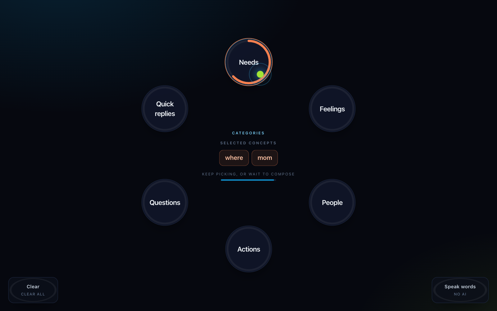
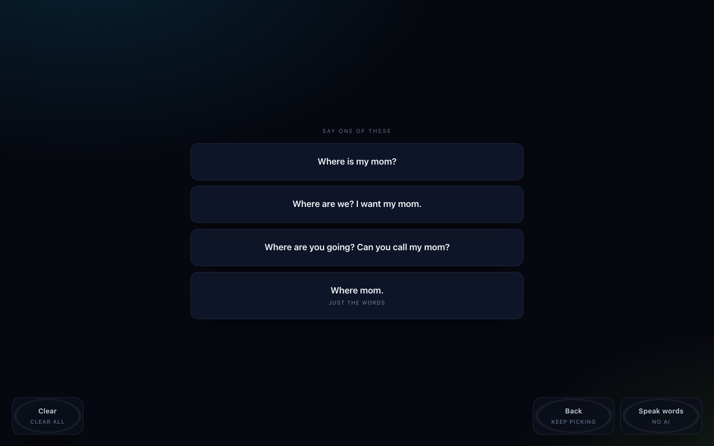

<p align="center">
  <picture>
    <source media="(prefers-color-scheme: dark)" srcset="public/logo-wordmark-dark.svg" />
    
  </picture>
</p>

# EyeTalk

A gaze-controlled AAC (augmentative and alternative communication) board that
runs entirely in your browser. It is built for people who cannot speak or type - for
example people living with ALS, cerebral palsy, or locked-in conditions - and for the
caregivers and families who talk with them. You point with your face - a small head turn
plus your eyes - and build sentences by looking at words.

<p align="center">
  
  
</p>
<p align="center"><sub>Pick words by turning toward them and holding until the ring fills, then pick the sentence to speak.</sub></p>

## How it works

<picture>
  <source media="(prefers-color-scheme: dark)" srcset="docs/pipeline-dark.svg" />
  
</picture>

## Why this matters

Existing eye-gaze AAC systems usually need dedicated hardware and run hundreds to
thousands of dollars, putting them out of reach for a lot of families and clinics.
EyeTalk needs only a webcam and a browser: nothing leaves your machine, there is no
account, and no data is ever sent anywhere except a one-time model download. Open a
category, look at a word, hold your gaze until the ring fills, and an on-device language
model turns your picks into a full sentence and speaks it out loud.

## Try it live

[EyeTalk](https://eyetalkaac.vercel.app/)

First load downloads a language model (~570 MB on WebGPU, ~786 MB on the no-GPU fallback)
so it can run fully on-device; your browser caches it after that, so every later visit
starts instantly. Chrome or Edge is recommended - WebGPU generates sentences seconds
faster than the CPU fallback path.

## Run it locally

Prerequisites: Node.js 18+, a webcam, and Chrome or Edge (recommended).

```bash
npm install
npm run dev          # http://localhost:5173
npm test             # gaze-math and vocabulary checks
```

## Vocabulary

The board opens on a ring of six categories. Each one opens a ring of eight words:

| Category | Words |
| --- | --- |
| Needs | water, food, bathroom, medicine, help, more, blanket, phone |
| Feelings | hurt, tired, happy, sad, scared, cold, hot, sick |
| People | mom, dad, brother, sister, friend, nurse, doctor, caregiver |
| Actions | stop, wait, go, eat, drink, sleep, move, read |
| Questions | what, where, when, who, why, how, how long, are you |
| Quick replies | yes, no, maybe, please, thank you, okay, not now, not sure |

Picked words stay selected while you move between categories, so one message can mix
words from several of them ("where" + "mom" becomes "Where is my mom?"). Speak and Clear
empty the selection and return to the categories.

The board is kept deliberately bare: the word ring and a few large action tiles, with no
status panels, history column or settings menu. You point with your face: a small head
turn plus your eyes. Eyes alone move the pointer less, so head plus eyes
is the intended use. A 13-dot calibration (about 15 seconds) asks you to follow each dot with
your head and eyes. It fits where your centre is, a 2x2 map from your head and eye signal to
the ring, a small curvature term, and your personal eye gain. The model is stored in angles,
so the same calibration survives resizing the window or moving to another screen. It keeps
correcting itself as you select words and while you rest on the centre text.

## Controls

| Control | By gaze | Also |
| --- | --- | --- |
| Open a category | dwell on a category tile in the ring | click |
| Pick a word | dwell on a word tile in the ring | click |
| Back to the category ring | dwell on `Back to categories` | click |
| Speak / Clear / Back | dwell on a bottom action tile | click |
| Remove a picked word | - | click the selected word |
| Recalibrate | - | `C` (caregiver) |
| Stop speech | - | `S` (caregiver) |
| Hide / show the camera view | - | `D` (caregiver) |
| Accuracy check: 9 dots, then mean / worst error in degrees and px | - | `A` (caregiver) |
| Cancel and go back to the categories | shut both eyes for about half a second | - |

Every tile is also clickable, so the whole app works with just a mouse if the camera is
unavailable.

## Simulated test results

`npm test` checks the face pointer (the 13-dot fit with its curvature term, eye gain and sign
measurement, mapping, implicit recalibration and the calibration guards)
against synthetic calibration captures with a known true mapping. These are synthetic results,
not measurements from real users or real webcams. A ring radius is the distance from the
centre to the word ring:

| Simulated scenario | Result |
| --- | --- |
| Pointer fit with a 10 deg camera roll and 1.3x anisotropy: worst of the 13 dots | 0.004 ring radii |
| Perspective bend on held-out looks: affine-only vs with the curvature term (rms) | 0.073 vs 0.032 ring radii |
| Eye gain of a user who mostly moves the eyes, generated with gain 2.5 | fitted 2.5 |
| Pointer fit with one garbage (blink) frame on every dot | moves 0.002 ring radii |
| Pointer after a 3 deg per-axis shift in sitting position, before vs after 4 implicit recalibrations | 4.2 deg vs 0.3 deg |
| Same fitted pointer on a 1440x900 and a 1920x1080 window (no recalibration) | 8/8 ring tiles picked on both |
| One Euro filter under +-4 px input noise | 2.03 px max deviation |

It also checks that every one of the 48 words has its own template sentences, and that
the template fallback produces three sentences for every pair of words from two different
categories.

## Known limitations

- Webcam-only gaze tracking has a real accuracy floor - published appearance-based methods and
  commercial webcam trackers alike sit around 90-190 px of error on a laptop screen, not a
  number EyeTalk's software is failing to clear. The session-drift and outlier-frame problems
  that *are* fixable are; raw
  single-shot calibration precision on an arbitrary webcam is closer to a hardware limit.
- Head movement is the main signal, and a small head turn toward each word is the intended
  way to use it, so a user who cannot move the head at all will find the pointer harder to
  steer. Sitting somewhere very different (new chair, moved
  desk) needs a recalibration (`C`). Smaller drift over the course of a session - shifting in
  the seat, the laptop getting nudged - self-corrects from normal use, one selection at a
  time, and while you rest on the centre text.
- The eye term is only as good as the iris tracking: with glasses or low lids it is weak, so
  the pointer leans on head movement. A user who can move neither the head nor the eyes much
  is rejected at calibration with a prompt to try again.
- Only one face is followed: if two are in view, the one nearest the camera wins.
- Vertical accuracy is inherently worse than horizontal: the whole screen height moves the
  iris by only a pixel or two on a laptop webcam. Sitting closer, with the camera near eye
  level and the browser full screen, helps more than anything in the software.
- The on-device model is small (0.6B params on WebGPU, 0.5B on the CPU fallback) and can
  produce something clumsy or off-topic; the app filters the worst of it and tops up with templates either way.
- Blink-to-cancel is less reliable behind glasses with strong reflections.
- The vocabulary is a fixed set of 48 words in six categories. Words and categories cannot
  yet be added or edited from inside the app.
- Every word takes two selections (its category, then the word), so even an urgent word
  like "help" is two dwells away.
- Template-fallback sentences that combine several words are assembled from fixed
  patterns and can read stiffly ("Thank you, I want the nurse.").
- Nothing persists across a reload: the fitted calibration and current conversation are
  lost, so calibration needs to be redone.

---

Curious how the gaze tracking, calibration, and fallback system actually work? See
[ARCHITECTURE.md](ARCHITECTURE.md).

## How this was built

I designed and planned EyeTalk and programmed the main blueprint of the app myself. I used
Claude, Anthropic's AI assistant, to help with:

- **Review.** Claude went over my code, checked it for errors, and made it more robust.
- **Performance.** Claude helped optimize the app so it runs better on slower computers.
- **Testing.** Claude ran the builds and test suite and checked that the app runs on other
  machines, not just mine.
- **The website.** Claude helped build the site itself and clean up the UI.
- **Wrap-up.** Once everything was done, Claude helped structure the project, clean up what
  was left, and put together the GitHub repo and this README.

## Open-source credits

EyeTalk is built on these open-source projects:

- [MediaPipe Face Landmarker](https://ai.google.dev/edge/mediapipe) (Google, Apache 2.0): face and iris landmarks
- [Transformers.js](https://github.com/huggingface/transformers.js) (Hugging Face, Apache 2.0) and ONNX Runtime Web (Microsoft, MIT): on-device language model
- [Qwen3-0.6B](https://huggingface.co/onnx-community/Qwen3-0.6B-ONNX) and [Qwen2.5-0.5B-Instruct](https://huggingface.co/onnx-community/Qwen2.5-0.5B-Instruct) (Alibaba Qwen team, Apache 2.0): sentence generation
- [Vite](https://vite.dev) and [Tailwind CSS](https://tailwindcss.com) (MIT): build and styling

The face pointer, One Euro filter, calibration, and dwell selection are my own code.

## License

MIT
